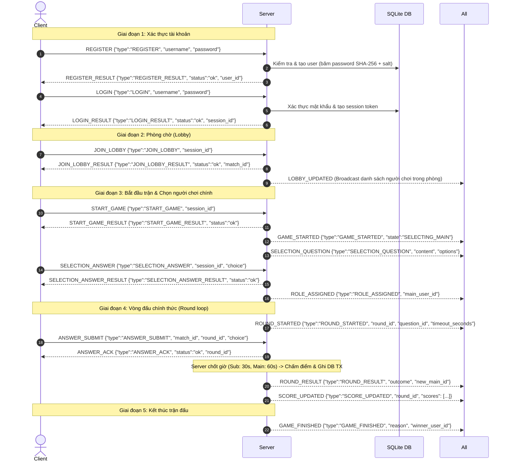

# TÀI LIỆU GIAO THỨC TRUYỀN THÔNG (NETWORK PROTOCOL SPECIFICATION)
## Dự án: Đấu trường tri thức (Knowledge Arena) — IT4062

---

## 1. CƠ CHẾ ĐÓNG GÓI VÀ GIỚI HẠN KÍCH THƯỚC (FRAMING & LIMITS)

### 1.1 Cơ chế phân tách thông điệp (Message Framing)
- **Giao thức tầng vận chuyển (Transport Layer):** TCP (Transmission Control Protocol), đảm bảo luồng byte tin cậy, theo thứ tự.
- **Quy tắc phân đoạn (Delimiter Framing):** Mỗi thông điệp trao đổi giữa Client và Server là một chuỗi JSON hợp lệ được kết thúc bằng ký tự ngắt dòng `\n` (newline character `0x0A`).
  - Hỗ trợ loại bỏ ký tự carriage return `\r` (`\r\n`) trong quá trình trích xuất.
  - Phía nhận sử dụng bộ đệm tích lũy `NetRecvBuffer` để xử lý các phân đoạn nhận dở dang (partial TCP stream) hoặc nhận nhiều gói tin cùng lúc (TCP packet coalescing).

### 1.2 Giới hạn kích thước và tham số hệ thống
| Tham số | Giá trị | Mô tả |
| :--- | :--- | :--- |
| `NET_MAX_MSG_LEN` | `8,192 bytes` (8 KB) | Kích thước tối đa của một thông điệp JSON hoàn chỉnh |
| `NET_BUF_CAPACITY` | `16,384 bytes` (16 KB) | Kích thước bộ đệm tích lũy nhận dữ liệu socket (`NetRecvBuffer`) |
| `MAX_MATCH_PLAYERS` | `100` | Số lượng người chơi tối đa trong một phòng đấu |
| `INITIAL_SCORE_UNITS` | `1,000` units | Điểm khởi đầu của mỗi người chơi khi vào trận (100 units = 1 điểm thi) |
| `TIMEOUT_SUB_SECONDS` | `30 giây` | Hạn giờ nộp đáp án cho người chơi phụ |
| `TIMEOUT_MAIN_SECONDS`| `60 giây` | Hạn giờ nộp đáp án cho người chơi chính |
| `SO_SNDTIMEO` (Broadcast) | `1,000 ms` | Timeout gửi dữ liệu tránh 1 client chậm gây nghẽn luồng phát thông báo |
| `SESSION_EXPIRY_SECONDS` | `86,400 giây` (24h) | Thời gian hiệu lực của phiên đăng nhập |

---

## 2. TRÌNH TỰ TRAO ĐỔI TỔNG THỂ (PROTOCOL LIFECYCLE)



---

## 3. CHI TIẾT CÁC BẢN TIN VÀ ĐẶC TẢ TRƯỜNG DỮ LIỆU

### 3.1 Nhóm xác thực (Authentication)

#### 1. `REGISTER` (Client ➔ Server)
- **Mục đích:** Đăng ký tài khoản người dùng mới.
- **Trường bắt buộc:**
  - `type` (string): `"REGISTER"`
  - `username` (string): Độ dài từ 3 đến 32 ký tự
  - `password` (string): Độ dài tối thiểu 6 ký tự
- **Ví dụ JSON:**
```json
{"type":"REGISTER","username":"alice","password":"secret_password_123"}
```

#### 2. `REGISTER_RESULT` (Server ➔ Client)
- **Trường dữ liệu:**
  - `type`: `"REGISTER_RESULT"`
  - `status`: `"ok"` hoặc `"error"`
  - `payload`:
    - `user_id` (integer): ID tài khoản nếu thành công
    - `username` (string): Tên đăng ký
    - `error_code` (string, nếu lỗi): `"INVALID_INPUT"`, `"USER_EXISTS"`, `"INTERNAL_ERROR"`
    - `message` (string, nếu lỗi): Thông báo giải thích lỗi
- **Ví dụ thành công:**
```json
{"type":"REGISTER_RESULT","status":"ok","payload":{"user_id":1,"username":"alice"}}
```
- **Ví dụ thất bại:**
```json
{"type":"REGISTER_RESULT","status":"error","payload":{"error_code":"USER_EXISTS","message":"Tên đăng nhập đã tồn tại"}}
```

#### 3. `LOGIN` (Client ➔ Server)
- **Mục đích:** Xác thực và xin cấp thẻ phiên (`session_id`).
- **Trường bắt buộc:**
  - `type` (string): `"LOGIN"`
  - `username` (string)
  - `password` (string)
- **Ví dụ JSON:**
```json
{"type":"LOGIN","username":"alice","password":"secret_password_123"}
```

#### 4. `LOGIN_RESULT` (Server ➔ Client)
- **Trường dữ liệu:**
  - `status`: `"ok"` hoặc `"error"`
  - `payload`:
    - `session_id` (string): Chuỗi token phiên 64 ký tự hex ngẫu nhiên
    - `user_id` (integer)
    - `username` (string)
    - `error_code` (nếu lỗi): `"INVALID_INPUT"`, `"AUTH_FAILED"`, `"INTERNAL_ERROR"`
- **Ví dụ thành công:**
```json
{"type":"LOGIN_RESULT","status":"ok","payload":{"session_id":"7c9e6679f...","user_id":1,"username":"alice"}}
```

#### 5. `LOGOUT` (Client ➔ Server)
- **Mục đích:** Hủy phiên làm việc và rời phòng nếu đang ở sảnh chờ.
- **Trường bắt buộc:**
  - `type`: `"LOGOUT"`
  - `session_id`: Token phiên làm việc
- **Ví dụ JSON:**
```json
{"type":"LOGOUT","session_id":"7c9e6679f..."}
```

---

### 3.2 Nhóm phòng chờ (Lobby Management)

#### 6. `JOIN_LOBBY` (Client ➔ Server)
- **Mục đích:** Đăng ký vào hàng đợi thi đấu.
- **Trường bắt buộc:** `type`: `"JOIN_LOBBY"`, `session_id`: Token phiên.
- **Ví dụ JSON:**
```json
{"type":"JOIN_LOBBY","session_id":"7c9e6679f..."}
```

#### 7. `JOIN_LOBBY_RESULT` (Server ➔ Client)
- **Trường dữ liệu:**
  - `status`: `"ok"` hoặc `"error"`
  - `payload`: `match_id` (int), `player_count` (int), `message` (string)
  - `error_code` (nếu lỗi): `"UNAUTHORIZED"`, `"INVALID_STATE"`, `"ALREADY_JOINED"`, `"LOBBY_FULL"`
- **Ví dụ thành công:**
```json
{"type":"JOIN_LOBBY_RESULT","status":"ok","payload":{"match_id":101,"player_count":3,"message":"Tham gia phòng chờ thành công"}}
```

#### 8. `LOBBY_UPDATED` (Server ➔ All Clients Broadcast)
- **Mục đích:** Cập nhật danh sách người chơi hiện có trong sảnh chờ thời gian thực.
- **Ví dụ JSON:**
```json
{"type":"LOBBY_UPDATED","match_id":101,"player_count":2,"players":[{"user_id":1,"username":"alice"},{"user_id":2,"username":"bob"}]}
```

#### 9. `START_GAME` (Client Host ➔ Server)
- **Mục đích:** Người dùng khởi xướng bắt đầu trận đấu (chỉ hợp lệ khi phòng có tối thiểu 2 người).
- **Ví dụ JSON:**
```json
{"type":"START_GAME","session_id":"7c9e6679f..."}
```

#### 10. `START_GAME_RESULT` (Server ➔ Client Host)
- **Ví dụ phản hồi:**
```json
{"type":"START_GAME_RESULT","status":"ok","payload":{"message":"Bắt đầu trận đấu thành công"}}
```

---

### 3.3 Nhóm phân vai người chơi chính (Main Selection Phase)

#### 11. `GAME_STARTED` (Server ➔ All Clients Broadcast)
- **Mục đích:** Thông báo trận đấu bắt đầu, phòng chuyển sang trạng thái phân vai.
- **Ví dụ JSON:**
```json
{"type":"GAME_STARTED","match_id":101,"player_count":3,"state":"SELECTING_MAIN","initial_score":10}
```

#### 12. `SELECTION_QUESTION` (Server ➔ All Clients Broadcast)
- **Mục đích:** Gửi câu hỏi khởi động để chọn người chơi chính (người trả lời đúng sớm nhất).
- **Lưu ý bảo mật:** Server **tuyệt đối không gửi trường đáp án đúng** sang Client.
- **Ví dụ JSON:**
```json
{"type":"SELECTION_QUESTION","match_id":101,"payload":{"question_id":501,"content":"Thủ đô của Việt Nam là gì?","options":{"A":"Đà Nẵng","B":"Hà Nội","C":"Hồ Chí Minh","D":"Cần Thơ"}}}
```

#### 13. `SELECTION_ANSWER` (Client ➔ Server)
- **Mục đích:** Nộp đáp án câu hỏi chọn người chơi chính.
- **Trường bắt buộc:** `session_id`, `choice` (`"A"`, `"B"`, `"C"`, `"D"`).
- **Ví dụ JSON:**
```json
{"type":"SELECTION_ANSWER","session_id":"7c9e6679f...","choice":"B"}
```

#### 14. `ROLE_ASSIGNED` (Server ➔ All Clients Broadcast)
- **Mục đích:** Thông báo người chơi chính đã được phân định.
- **Ví dụ JSON:**
```json
{"type":"ROLE_ASSIGNED","match_id":101,"payload":{"main_user_id":1,"main_username":"alice"}}
```

---

### 3.4 Nhóm thi đấu chính thức (Official Match Rounds)

#### 15. `ROUND_STARTED` (Server ➔ All Clients Broadcast)
- **Mục đích:** Bắt đầu một vòng thi mới kèm nội dung câu hỏi và thời gian quy định.
- **Ví dụ JSON:**
```json
{"type":"ROUND_STARTED","match_id":101,"payload":{"round_id":1,"question_id":2001,"content":"Giao thức nào cung cấp luồng byte tin cậy?","options":{"A":"UDP","B":"IP","C":"TCP","D":"ICMP"},"timeout_seconds":60}}
```

#### 16. `ANSWER_SUBMIT` (Client ➔ Server)
- **Mục đích:** Người chơi (cả chính và phụ) nộp đáp án cho vòng thi.
- **Trường bắt buộc:** `session_id`, `match_id`, `round_id`, `choice`.
- **Ví dụ JSON:**
```json
{"type":"ANSWER_SUBMIT","session_id":"7c9e6679f...","match_id":101,"round_id":1,"choice":"C"}
```

#### 17. `ANSWER_ACK` (Server ➔ Client)
- **Mục đích:** Xác nhận Server đã nhận và hợp thức hóa đáp án.
- **Trường mã lỗi trả về (`res`):**
  - `OK` (0): Chấp nhận đáp án hợp lệ.
  - `UNAUTHORIZED` (1): Session token không hợp lệ hoặc không có trong phòng.
  - `INVALID_MATCH` (2): `match_id` không khớp với trận đang chạy.
  - `INVALID_ROUND` (3): `round_id` không khớp với vòng thi hiện tại.
  - `INVALID_STATE` (4): Vòng thi chưa bắt đầu hoặc đã bị chốt sổ.
  - `TIMEOUT` (5): Hết hạn nộp bài (Quá 30s với người phụ, quá 60s với người chính).
  - `INVALID_CHOICE` (6): Đáp án không thuộc `{A, B, C, D}`.
  - `ALREADY_SUBMITTED` (7): Người chơi đã nộp đáp án trước đó trong cùng lượt.
- **Ví dụ thành công:**
```json
{"type":"ANSWER_ACK","status":"ok","payload":{"round_id":1,"message":"Ghi nhận đáp án thành công"}}
```
- **Ví dụ bị từ chối:**
```json
{"type":"ANSWER_ACK","status":"error","payload":{"error_code":"TIMEOUT","message":"Đã hết thời gian nộp đáp án cho vai trò của bạn"}}
```

#### 18. `ROUND_RESULT` (Server ➔ All Clients Broadcast)
- **Mục đích:** Công bố kết quả tổng kết vòng thi.
- **Các trường kết quả chính (`outcome`):**
  - `MAIN_CORRECT`: Người chính đúng ➔ gom điểm của tất cả người phụ trả lời sai/hết giờ, các người phụ này bị loại.
  - `MAIN_WRONG`: Người chính sai/hết giờ ➔ người chính bị loại. Điểm của người chính chia đều cho những người phụ còn sống. Người phụ trả lời đúng nhanh nhất được chỉ định làm tân người chơi chính (`new_main_id`).
- **Ví dụ JSON:**
```json
{"type":"ROUND_RESULT","match_id":101,"payload":{"round_id":1,"outcome":"MAIN_CORRECT","old_main_id":1,"new_main_id":1}}
```

#### 19. `SCORE_UPDATED` (Server ➔ All Clients Broadcast)
- **Mục đích:** Cập nhật bảng điểm công khai của tất cả người chơi sau biến động điểm ở vòng thi.
- **Quy tắc:** Chỉ phát thông tin điểm của người chơi `ACTIVE` hoặc `ELIMINATED`, không gửi thông tin người đã `DISCONNECTED`.
- **Ví dụ JSON:**
```json
{"type":"SCORE_UPDATED","match_id":101,"payload":{"round_id":1,"scores":[{"user_id":1,"username":"alice","score":2000,"status":1,"role":1},{"user_id":2,"username":"bob","score":0,"status":2,"role":2}]}}
```

---

### 3.5 Nhóm kết thúc trận & Báo lỗi hệ thống

#### 20. `GAME_FINISHED` (Server ➔ All Clients Broadcast)
- **Mục đích:** Trận đấu hoàn tất.
- **Lý do kết thúc (`reason`):**
  - `"MAIN_WINS"`: Người chơi chính đánh bại toàn bộ đối thủ phụ còn lại.
  - `"ALL_WRONG"`: Cả người chính và toàn bộ người phụ đều trả lời sai, không có người thắng cuộc (`winner_user_id: -1`).
  - `"LAST_SURVIVOR"`: Chỉ còn lại duy nhất một người chơi sống sót sau các lượt thi.
- **Ví dụ JSON:**
```json
{"type":"GAME_FINISHED","match_id":101,"payload":{"reason":"MAIN_WINS","winner_user_id":1,"message":"Người chơi chính đã chiến thắng trận đấu!"}}
```

#### 21. `ERROR` (Server ➔ Client)
- **Mục đích:** Phản hồi thông báo lỗi chung khi nhận phải dữ liệu rác, lỗi cú pháp hoặc bất thường mạng.
- **Ví dụ JSON:**
```json
{"type":"ERROR","status":"error","payload":{"code":"INVALID_JSON","message":"Thông điệp JSON không hợp lệ hoặc không hỗ trợ"}}
```

---

## 4. CƠ CHẾ XỬ LÝ MẤT KẾT NỐI (DISCONNECT HANDLING)

1. **Client mất kết nối trong phòng chờ (Lobby Phase):**
   - Khi `net_recv_message()` trả về `NET_STATUS_EOF` hoặc lỗi socket `NET_STATUS_ERR_SOCKET`:
   - Server lập tức thu hồi và xóa player khỏi RAM (`match_remove_player()`).
   - Gọi `db_session_invalidate_all_for_user()` vô hiệu hóa phiên đăng nhập trong Database.
   - Phát thông báo `LOBBY_UPDATED` cho các client còn lại trong phòng.
2. **Client mất kết nối trong trận đấu (In-Game Phase):**
   - Trạng thái người chơi được đánh dấu `PLAYER_STATUS_DISCONNECTED`.
   - Socket `socket_fd` được gán về `-1` và đóng bằng `CLOSE_SOCKET()`.
   - Các bản tin broadcast tiếp theo tự động lọc bỏ socket âm để tránh làm nghẽn quá trình gửi thông điệp tới người chơi còn sống.
   - Khi phân chia điểm hoặc chấm giải, người chơi mất kết nối không được chia thêm điểm.
3. **Thu hồi tài nguyên luồng (Thread Cleanup):**
   - Mỗi kết nối client được phục vụ bởi một luồng độc lập (`handle_client_thread`).
   - Khi thoát vòng lặp nhận dữ liệu: giải phóng `NetRecvBuffer`, giải phóng `msg_buf`, giảm biến đếm `g_active_clients` dưới khóa mutex `lock_sync()`, và giải phóng bộ nhớ `ClientContext`.
   - Server vẫn tiếp tục hoạt động và phục vụ các kết nối khác bình thường.
